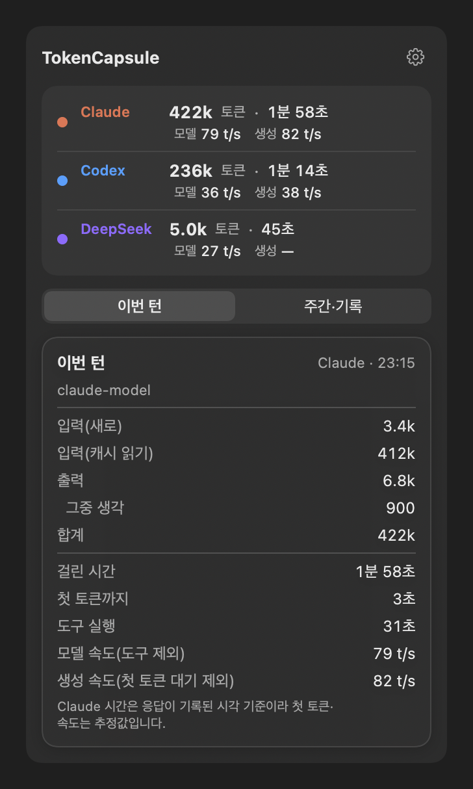
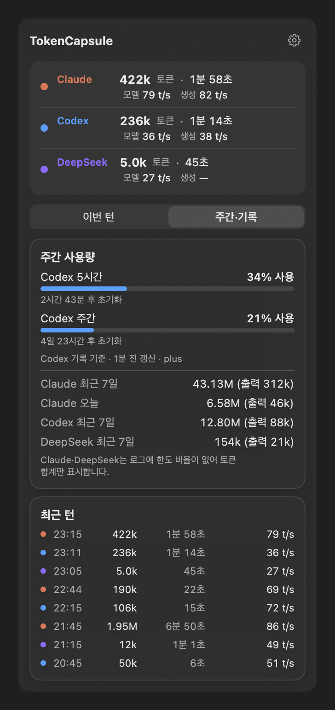
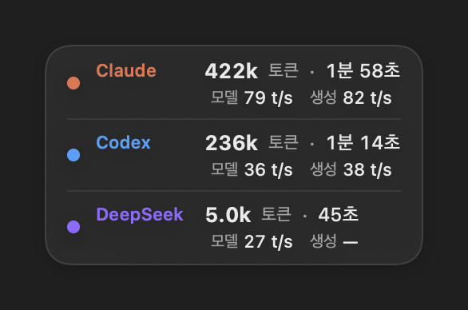

# TokenCapsule

macOS 메뉴 막대(상단바) 앱. Claude Code, Codex, DeepSeek(Qoder)의 **마지막 턴 토큰·시간·속도**와 주간 사용량을 상단바 아이콘 하나로 보여 준다.

> A macOS menu-bar overlay that shows per-turn token usage, duration and output speed for Claude Code, Codex and DeepSeek (Qoder), plus Codex 5-hour/weekly limits. It reads local log files only — no network, no conversation text.

| 상단바 아이콘 클릭: 이번 턴 | 주간·기록 탭 |
|---|---|
|  |  |

<sub>스크린샷은 데모 데이터다.</sub>

## 기능

- **상단바 아이콘**: 마지막 턴의 토큰 수가 아이콘 옆에 표시된다.
- **아이콘 클릭 → 패널**:
  - 위쪽: 모델별 마지막 턴. 최근 15분 안에 쓴 모델마다 한 줄씩 합계 토큰, 걸린 시간, 모델·생성 속도를 보여 준다.
  - **이번 턴** 탭: 입력(새로·캐시 읽기·캐시 쓰기), 출력, 생각 토큰과 첫 토큰까지·도구 실행 시간.
  - **주간·기록** 탭: Claude·Codex 5시간·주간 한도 %와 초기화까지 남은 시간, Claude 7일·오늘 토큰, Codex·DeepSeek 7일 토큰, 최근 턴 8개.
- **우클릭(또는 패널의 ⚙︎) → 설정**:
  - 모델별로 보기 / 최근 턴 하나만 보기
  - 모델·생성 속도 줄 켜기·끄기
  - Claude 한도 연결 (아래 참고)
  - 로그인 시 자동 실행
  - 화면 위 캡슐 띄우기(선택)
- **화면 위 캡슐(선택, 기본 꺼짐)**: TokenOverlay처럼 화면 위에 작은 캡슐을 띄운다. 클릭하면 이번 턴이, Ctrl을 누른 채 올리면 주간 사용량이 펼쳐진다. 드래그로 옮길 수 있다. 항상 표시하거나 Claude·Codex·Qoder 앱 사용 중일 때만 표시할 수 있다.

<p align="center"></p>

## 속도 두 가지

한 턴은 보통 `첫 토큰 대기 → 글 쓰기 → 도구 실행 → 글 쓰기 …` 순서로 흘러간다.

| 표시 | 계산 | 쓰임 |
|---|---|---|
| **모델** | 출력 토큰 ÷ (전체 시간 − 도구 실행 시간) | 모델끼리 비교할 때. 세 소스 모두 같은 기준으로 계산된다 |
| **생성** | 출력 토큰 ÷ (전체 시간 − 도구 실행 − 첫 토큰 대기) | 순수 생성 속도. 모델 속도와 차이가 크면 첫 응답 대기가 길었다는 뜻 |

생성 속도는 Codex에서 가장 정확하다. 로그에 첫 토큰 시간이 있기 때문이다.

- **Claude Code**: 응답이 기록된 시각으로 첫 토큰 시간을 추정하므로 생성 속도가 다소 높게 나올 수 있다.
- **DeepSeek 워커**: 첫 토큰 시간이 없어서 `—`로 표시한다.

평소에는 **모델 속도**를 보는 것을 권장한다.

## 설치

필요한 것: Apple Silicon Mac, macOS 14 이상, Xcode Command Line Tools(`xcode-select --install`). Xcode 본체는 필요 없다.

```sh
git clone https://github.com/kritikal619/TokenCapsule.git
cd TokenCapsule
./build.sh
open ~/Applications/TokenCapsule.app
```

`build.sh`는 `swiftc`로 컴파일하고 ad-hoc 서명한 뒤 `~/Applications/TokenCapsule.app`에 설치한다. 업데이트할 때는 `git pull && ./build.sh` 후 앱을 다시 실행한다.

## 읽는 데이터

모든 처리는 로컬에서 한다. 네트워크 요청이 없다. **대화 내용, 도구 입력·출력, 답변 텍스트는 읽지 않고** 숫자 사용량·시각·ID만 쓴다. 최근 8일 안에 바뀐 파일만 읽는다. 처음에 한 번 전체를 읽고, 그 뒤 2초마다 새로 추가된 줄만 읽는다.

| 소스 | 위치 | 쓰는 값 |
|---|---|---|
| Claude Code | `~/.claude/projects/**/*.jsonl` | assistant 메시지의 `usage`, `stop_reason`, 도구 호출·결과 시각. 같은 메시지 id는 한 번만 센다. 서브에이전트 기록은 토큰 합계에만 넣는다 |
| Codex | `~/.codex/sessions/**/rollout-*.jsonl` | `token_usage_record`, `task_complete`의 `duration_ms`·`time_to_first_token_ms`, `token_count`의 `rate_limits`, 도구 호출·결과 시각 |
| DeepSeek (Qoder CLI) | `~/.qoder/projects/**/*.jsonl` | Claude Code와 같은 형식 |
| DeepSeek (Qoder 워커) | `~/.codex/skills/qoder-delegate/usage.jsonl` | 아래 형식의 숫자 기록 |

DeepSeek는 로그에 한도 비율이 없어서 토큰 합계만 보여 준다.

### Claude 5시간·주간 한도

Claude Code의 대화 기록에는 한도가 없지만, Claude Code는 상태줄(status line) 명령에 `rate_limits`를 넘겨준다. 내용은 5시간·7일 사용률과 초기화 시각이고, Claude 구독 계정에서만 나온다. 설정 메뉴의 **Claude 한도 연결**을 켜면 TokenCapsule이 `~/.claude/settings.json`의 `statusLine`에 자기 자신(`TokenCapsule --statusline`)을 등록한다. 등록 전에 설정 파일을 `settings.json.tokencapsule-backup-*`로 백업한다.

- 상태줄이 그려질 때마다 한도 숫자만 `~/Library/Application Support/TokenCapsule/claude-limits.json`에 저장하고, 상태줄에는 `Claude 5h 24% · 주간 41%`처럼 표시한다. 인증 정보는 읽지 않는다.
- 이미 다른 상태줄을 쓰고 있으면 바꿀지 먼저 묻는다. 끄면 `statusLine` 항목을 지운다.
- 상태줄을 그리는 Claude Code(터미널 등)에서 응답을 받아야 갱신된다. 마지막 갱신 시각이 함께 표시된다.

### Qoder 워커 기록 형식

Qoder를 `qodercli -p --no-session-persistence`로 호출하면 세션 기록이 남지 않는다. 호출하는 쪽(브리지 스크립트 등)이 결과 JSON의 숫자만 한 줄씩 남기면 TokenCapsule이 읽는다. 토큰이 0인 줄(대기열에서 끝났거나 취소된 호출)은 건너뛴다.

```json
{"timestamp": "2026-10-20T14:10:00.000Z", "model": "DeepSeek-Flash", "mode": "implement",
 "usage": {"input_tokens": 1200, "cache_read_input_tokens": 3000, "cache_creation_input_tokens": 0, "output_tokens": 800},
 "duration_ms": 45000, "duration_api_ms": 30000}
```

도구 실행 시간은 `duration_ms − duration_api_ms`로 계산한다.

## 한계

- 턴이 끝나야 캡슐에 나타난다. 진행 중인 턴은 표시하지 않는다.
- Claude Code 턴의 경계는 사용자 입력부터 `stop_reason`이 `end_turn` 등으로 끝나는 응답까지다. 중간에 중단한 턴은 다음 입력 때 마무리된다.
- 토큰 합계에는 캐시 읽기가 포함된다. 그래서 긴 세션에서는 수백만 단위로 커질 수 있다. 출력만 보려면 상세 화면을 본다.
- 여러 기기 합치기와 자동 업데이트는 없다.

## 개발

```
Sources/Logs.swift    로그 읽기 (증분 tail, 소스별 파서, 집계)
Sources/UI.swift      SwiftUI 화면, 오버레이 패널, 메뉴 막대
Sources/main.swift    앱 시작
Tools/check           로그를 읽어 최근 턴·한도를 숫자로 출력
Tools/render          화면을 PNG로 렌더링 (demo 인자를 주면 데모 데이터)
```

```sh
# 화면 렌더링 (README 스크린샷)
mkdir -p build
swiftc -O -swift-version 5 -target arm64-apple-macos14.0 \
  Sources/Logs.swift Sources/UI.swift Tools/render/main.swift -o build/render-tool
./build/render-tool docs/images demo
```

## 크레딧

Windows용 [TokenOverlay](https://github.com/igayowai/TokenOverlay)(MIT)의 기능 구성을 참고했다. 코드는 새로 작성했다.

## 라이선스

MIT
